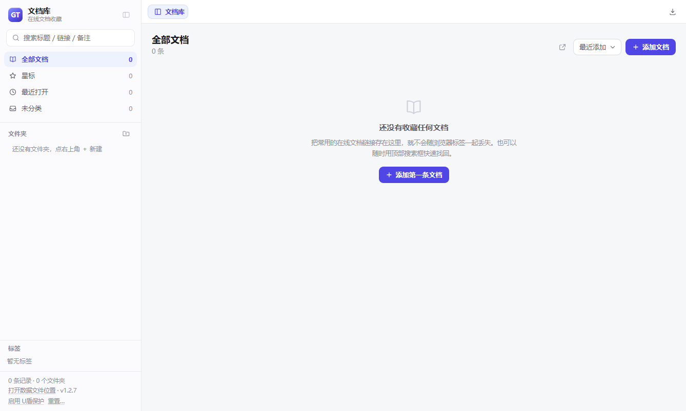
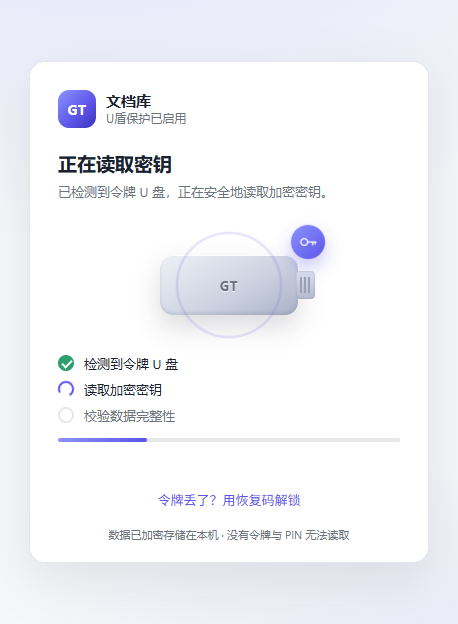
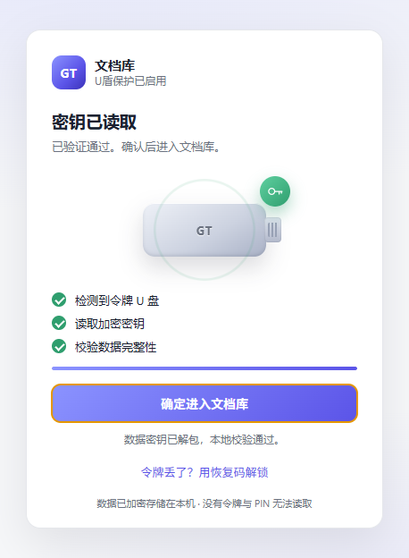
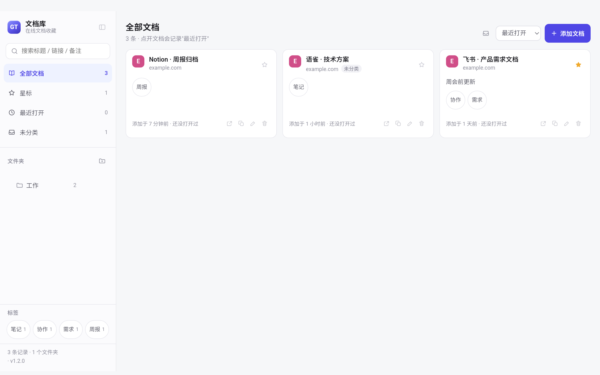

# 文档库（doc-vault）

用 Electron 做的**在线文档收藏夹**：把散落在浏览器标签里的在线文档链接长期存下来，需要时一键在应用内打开。

浏览器关掉标签就找不回来了，收藏夹又容易越堆越乱。这个软件只做一件事——**帮你记住链接**（不抓取网页内容、不做离线快照），并用文件夹树、标签和搜索让它们随时能被找回来。登录态由应用自己保留，常用站点不用反复登录。

## 功能

- **文件夹树**：可任意嵌套，父文件夹视图包含子文件夹的文档；删除文件夹时可选"仅删文件夹（文档移到未分类）"或"连同内容删除"。
- **标签 + 搜索**：标签跨文件夹标记，多个标签同时满足（AND）；搜索框对标题、链接、备注、标签做多关键词匹配（空格分隔 = AND）。
- **内置视图**：全部文档 / 星标 / 最近打开 / 未分类。
- **下载管理**：网页里点下载会直接存到「下载」目录，右上角出现下载记录（进度条、大小、完成/中断状态），可"在访达中显示"、"打开文件"，进行中的还能取消；记录跨重启保留最近 50 条。
- **侧栏可折叠**：点品牌行右侧的按钮把侧栏收成 64px 图标栏（只留品牌与四个视图，鼠标悬停有提示），状态会记住；看长文档时把横向空间全留给正文；在文档库界面按 `⌘F/Ctrl+F` 会自动展开侧栏再聚焦搜索（网页标签里的 `⌘F` 归网页自己，见「快捷键」）。
- **应用内打开**：每条文档一个标签页，标题栏显示当前地址，可就地后退、刷新、复制链接、切换系统浏览器；隐藏标签不渲染，降低占用。
- **标题自动补全**：添加时标题可以留空，第一次打开后自动取网页真实标题（只补一次，之后你改过的标题不会被覆盖）。
- **记录打开次数与最近打开时间**，方便回顾"存了但一直没用"的东西。
- **导出 / 导入**：右上角「导出」把整库（含文件夹、标签、星标、备注）存成一个 `.json`，
  文件名带日期；导出的文件同时也是 Android 端的导入格式，两边数据模型完全一致。
- **U盾保护（可选）**：侧栏底部「启用 U盾保护」后，整库加密存储——没有绑定的令牌 U 盘和 PIN，
  数据文件读不出来。拔盾即锁、空闲自动锁、休眠/锁屏即锁；令牌丢了可用恢复码救回数据。见下文。
- **数据完全在本地**，一个可读的 JSON 文件，随时备份、迁移、手工编辑（启用 U盾保护后为加密文件）。

## 下载

打好的安装包在 [Releases](https://gitee.com/gxt2821/web-desktop/releases) 里：

| 平台 | 文件 |
| --- | --- |
| macOS（Apple Silicon） | `DocVault-<版本>-arm64.dmg`（超过 100 MB 的按分块上传，见发布说明里的合并命令） |
| Windows（x64） | `DocVault-<版本>-win-x64-setup.exe`（安装版）、`-portable.exe`（免安装） |
| Linux（x64） | `DocVault-<版本>.AppImage`、`.deb` |
| Android 平板 | `DocVault-Android-<版本>-arm64.apk` |

每个版本都附 `SHA256SUMS.txt`，下载后可自行校验。也可以按「打包」一节自己构建。

## 界面

桌面端主界面：左侧文件夹树 / 标签 / 视图，右侧文档列表，每条文档在应用内以标签页打开。



启用 U盾保护后，启动先进入锁定页：插入令牌 U 盘 → 读取密钥动画 → 点「确定」进入。




## 运行

```bash
npm install     # 首次运行，下载 Electron
npm start
```

> Windows 上如果 PowerShell 拦 `npm.ps1`，请用 `npm.cmd`。

## 数据存在哪

| 系统 | 路径 |
| --- | --- |
| macOS | `~/Library/Application Support/DocVault/library.json` |
| Windows | `%APPDATA%\DocVault\library.json` |
| Linux | `~/.config/DocVault/library.json` |

> 启用 U盾保护后，数据文件变为同目录的 `library.enc`（AES-256-GCM 密文），
> 明文的 `library.json` 及其备份会被覆写删除；`vault.json` 存放加密元数据（不含密钥）。

- 写入采用"临时文件 + 原子替换"，覆盖前会留一份 `library.json.bak`；
- **主文件损坏时自动回退备份**，并把坏文件改名为 `library.json.corrupt-<时间>` 留档，不会静默丢数据；
- 下载记录存在同目录的 `downloads.json`（同样 `0600`），文件本身落在系统「下载」目录，可用 `DOCVAULT_DOWNLOAD_DIR` 改到别处；
- 侧栏底部「打开数据文件位置」可直接在访达/资源管理器中定位；
- 想把数据放到 iCloud、移动硬盘或做便携运行，可以用环境变量指定目录：
  ```bash
  DOCVAULT_DATA_DIR="/Volumes/U盘/DocVault" npm start
  ```

## 数据与隐私

这个工具没有账号体系，也没有任何统计，你的文档库就是本机的一个 JSON 文件。

- **存什么**：标题、链接、标签、文件夹、备注、星标、创建和打开时间。不保存网页正文、截图或附件。
- **存哪**：见上一节「数据存在哪」，默认在应用数据目录，文件权限 `0600`（仅自己可读）。
- **发给谁**：不发给任何人。代码里没有埋点、崩溃上报或自动更新检查，也不向第三方发任何请求——
  想核实的话，`git grep -n "fetch(\|sentry\|analytics\|telemetry"` 是空的。
- **什么时候联网**：只有你打开某个文档时，才会去访问那个网址本身。
- **登录态**：网页的 Cookie / localStorage 由 Electron 按站点保存在本机（和普通浏览器一样），
  文档库既不读取也不上传。想清掉就在网页里退出登录；直接删应用数据目录也能清，
  但那会连 `library.json` 一起删掉，先导出一份。
- **导出**：导出的 JSON 只包含上面那些字段，不含本机路径、账号或环境信息。
- **删除**：退出应用后删掉 `library.json` 即可，没有云端副本。

## 快捷键

| 快捷键 | 作用 |
| --- | --- |
| `Cmd/Ctrl + N` | 添加文档 |
| `Cmd/Ctrl + F` | 文档库界面：聚焦搜索框；**网页标签里：留给网页自己的页内查找** |
| `Cmd/Ctrl + W` | 关闭当前网页标签（「文档库」标签固定不关） |
| `Cmd/Ctrl + R` | 刷新当前网页 |
| `Cmd/Ctrl + 1~9` | 切换到第 N 个标签 |
| `F12` / `Cmd(Ctrl) + Alt + I` | 打开调试器（焦点在网页里时由主进程转发） |

网页标签里的按键归属：`Cmd/Ctrl + F` 一律交给网页（在线文档的「查找」靠它），
`W / R / N / 1~9` 由应用处理。规则在 `src/shortcuts.js`，有对应单测。

## 目录结构

```
doc-vault/
├── main.js          主进程：窗口、IPC、webview 策略（UA 清洗 / 弹窗拦截 / 导航白名单）、窗口尺寸记忆、U盾 lock-first
├── preload.js       安全桥：只暴露 window.api 的具体方法
├── preload-lock.js  锁定页安全桥：只暴露保险库方法（无 window.api）
├── src/
│   ├── store-core.js 数据核心：字段校验与增删改（桌面端和 Android 端共用同一份）
│   ├── store.js     数据层：library.json 的读写、原子写 + 备份 + 损坏恢复（可选加密 codec）
│   ├── vault.js     保险库：DEK 包装/解包、恢复码、加密容器（U盾保护核心）
│   ├── token/       令牌层：provider 发现 + 软件令牌（接口与硬件 U盾一致）
│   ├── lock.html    锁定页（PIN 解锁 / 恢复码绑定新令牌）
│   ├── shell.html   外壳结构（侧栏 + 标签栏 + 工具条 + 内容区 + 弹窗）
│   ├── shell.css    全部样式
│   ├── library.js   文档库：侧栏视图、文件夹树、标签、搜索、列表、增删改弹窗、U盾启用向导
│   ├── shell.js     标签页与 webview 管理、错误页、快捷键
│   ├── shortcuts.js 网页标签内的快捷键归属规则（Cmd/Ctrl+F 不拦）
│   ├── user-agent.js 抹掉 Electron 标识的 UA 构造
│   └── downloads.js 下载管理：进度、完成与失败通知
├── build/           图标资源（icon.svg 为设计源，icns/ico/多尺寸 png 为产物）
├── mobile/          Android 平板版（Tauri 2），见 mobile/README.md
├── test/            纯 Node 测试（数据层 + 快捷键规则 + 保险库）
├── docs/            文档用图
└── scripts/
    ├── build.js         跨平台打包入口
    ├── e2e-vault.js     U盾保护端到端回归（PIN 流程）
    ├── e2e-autounlock.js 免 PIN 插拔自动锁/解锁回归
    └── build-icons.js   图标生成：超椭圆形状 + 三个方案 + 设计评审图
```

## 应用图标

图标是**方案 A · 书签徽章**：靛蓝渐变方块 + 底部书签缺口 + 白色 **GT** 字标（GT 既是个人标识，也让图标在 48px 以上能直接被认出）。

- 画布 1024×1024，图形区 824×824（四周留 100 安全边距），轮廓是 **n=5 超椭圆**（贴近 macOS Big Sur 的 squircle，比普通圆角矩形更"顺"）；
- 主色沿用应用主题的靛蓝 `#8B93FF → #5B54E8 → #3B32B8`，浅色/深色背景下都够清楚；
- 侧栏左上角的品牌标记是同一套视觉的 CSS 版（渐变方块 + GT），见 `src/shell.css` 的 `.brand-mark`。

重新生成（改了设计后执行，产物会覆盖 `build/`）：

```bash
npm run icons
```

产物：`build/icon.icns`（macOS，含 16→1024 全部 10 个尺寸）、`build/icon.ico`（Windows，7 个尺寸）、`build/icons/*.png`（Linux）、`build/icon.png`（1024，开发期 Dock/窗口图标）、`build/preview.png`（设计评审图：三个方案对比 + 多尺寸观感 + 浅色/深色/Dock 场景）。

想换方案：打开 `scripts/build-icons.js`，把 `CONCEPTS` 里想要的方案标成 `chosen: true`，再跑一次 `npm run icons`。备选方案（B 文档叠层 / C 字标霓虹）的 SVG 也在 `build/concepts/` 里，可以直接拿去改。图标只在打包时用到，`build/` 不会打进应用包。

## 打包

```bash
npm ci                    # 首次：装依赖
npm run build:mac         # macOS → dist/DocVault-<版本>-arm64.dmg + .zip
```

其他平台：`npm run build:win` / `build:linux` / `build:all`（也等价于
`node scripts/build.js mac|win|linux|all`，产物都在 `dist/`）。

macOS 产物：

| 文件 | 用途 |
|---|---|
| `dist/DocVault-1.2.1-arm64.dmg` | 安装包，拖进「应用程序」 |
| `dist/DocVault-1.2.1-arm64.zip` | 绿色版，解压即用 |
| `dist/mac-arm64/文档库.app` | 未压缩的包，调试时可直接跑 |

### 流程里已经固定的三件事

这三条都在仓库里（不是每次手敲参数），换机器、换时间结果一致：

1. **Electron 运行时走镜像**：`scripts/build.js` 默认设置
   `ELECTRON_MIRROR=https://npmmirror.com/mirrors/electron/`。官方源在
   `github.com`，这个域名的 DNS 在部分网络下会偶发 `ENOTFOUND`，
   一失败整个打包就中断（现象：`getaddrinfo ENOTFOUND github.com`）。
   要回官方源：`ELECTRON_MIRROR=https://github.com/electron/electron/releases/download/ npm run build:mac`。
2. **构建缓存放仓库里**：`package.json` 里配了
   `electronDownload.cache = ".cache-electron"`，Electron 运行时（约 112 MB）
   存在仓库目录下，和 Android 的 `.cache-android` 一个思路。好处是不依赖
   `~/Library/Caches/electron` 的写权限（沙箱/CI/多用户机器上经常不可写，
   报 `EPERM ... mkdir`）。这个目录在 `.gitignore` 里，删掉只会让下次构建重新下载。
3. **不做身份签名**：`package.json` 里 `mac.identity = null`，跳过
   electron-builder 的钥匙串签名（否则在钥匙串锁定或无人值守的机器上会报
   `errSecInternalComponent` 直接失败）。签名统一由 `scripts/after-pack.js`
   补 ad-hoc 签名，且必须在翻转 fuses 之后做——Apple Silicon 上签名失效的
   二进制会被系统直接 SIGKILL。
4. **产物名带版本号**：来自 `package.json` 的 `version`，发版前改这里即可。

### 打完检查一遍

```bash
codesign -dv dist/mac-arm64/文档库.app 2>&1 | grep Signature   # 期望 Signature=adhoc
open dist/DocVault-*.dmg                                        # 拖进「应用程序」后打开，看底部版本号
```

### 遇到问题时先看错误类型

| 报错 | 原因 | 处理 |
|---|---|---|
| `getaddrinfo ENOTFOUND github.com` | 下 Electron 运行时失败 | 确认 `scripts/build.js` 里的镜像生效，或临时用 `ELECTRON_MIRROR=` 指定可用源 |
| `EPERM ... mkdir`（缓存目录） | 缓存目录不可写（改过 `electronDownload.cache` 或删了 `.cache-electron` 后父目录只读） | 确认仓库目录可写；缓存位置在 `package.json` 的 `electronDownload.cache` |
| `errSecInternalComponent` | electron-builder 尝试用钥匙串里的证书签名 | 已用 `identity: null` 规避；若自行改回身份签名，需先 `security unlock-keychain` |
| `hdiutil: create failed - 操作不被允许` | 生成 dmg 需要挂载磁盘映像的权限 | 受限环境里只能拿到 zip（zip 无此依赖）；在正常桌面环境执行即可 |
| 打开 App 报"无法验证开发者" | 只有 ad-hoc 签名，没有公证 | 右键 →「打开」，或 `xattr -dr com.apple.quarantine /Applications/文档库.app` |

正式分发需要 Apple Developer ID 证书 + 公证：配好 `CSC_LINK`/`CSC_NAME` 后，
`after-pack.js` 检测到有效签名会跳过 ad-hoc 重签，不会覆盖正式签名。

## Android 平板版

桌面版是 Electron，只能跑 macOS / Windows / Linux；平板上的「文档库」是另一个壳
（Tauri 2），复用同一套界面、同一套校验逻辑，数据存在本机。

分工是「电脑导出、平板导入」：备份这种要挑路径、要整理文件的事放在电脑上做，
平板只负责把电脑导出的 JSON 吃进来。



- 安装包：`dist/DocVault-Android-1.2.1-arm64.apk`（约 5.8 MB，Android 7.0+）
- 安装：`adb install -r dist/DocVault-Android-1.2.1-arm64.apk`，或拷到平板上点开安装
  （需允许"安装未知来源应用"）
- 打开文档走系统浏览器（第三方网页不允许被内嵌，登录态也留在浏览器里）
- 横竖屏都适配：平板横屏三列、竖屏单列；手机宽度下侧栏变成抽屉
- 数据迁移：电脑「导出」→ 把 JSON 传到平板 → 平板「导入」→ 选文件
  （粘贴也行，导入方式支持"合并"和"覆盖"两种模式）

构建方法、签名密钥（`.android-keys/`，**删了就没法覆盖升级**）和踩过的坑都写在
[`mobile/README.md`](mobile/README.md)。

## U盾保护（可选）

把"打开软件"变成"插盾 + PIN"：启用后整库加密，**没有令牌连数据文件都读不了**，
而不是只在界面上挡一道密码。

### 启用 / 日常使用

1. 侧栏底部点「启用 U盾保护」→ 选择一枚令牌（或在新位置创建）→ 设置/输入 PIN；
2. 向导最后展示一组 **32 位恢复码**——抄下来存到安全的地方，这是令牌丢失时唯一的救命稻草；
3. 之后每次启动先进锁定页：插着绑定的令牌 U 盘、输对 PIN 才进文档库；
4. 侧栏「锁定」可手动上锁；「停用」输 PIN 后还原为明文存储。

**免 PIN 模式（插入 → 读取动画 → 确定进入）**：创建令牌时勾选「免 PIN：插入即自动解锁」，
令牌不再设 PIN。锁定页检测到 U 盘后会播放「读取密钥」动画（U 盘滑入、扫描、三步校验依次打勾），
读完后出现 **「确定进入文档库」** 按钮，**点了才进入**；拔掉 U 盘 2 秒内自动上锁。
启动时插着令牌也一样：先动画、再确认，不会直接跳进主界面。
检测采用 400–500ms 的高频轮询 + 已知路径直读（约 0.07ms），插入后基本立刻响应。
带 PIN 的令牌**不会**被自动尝试读取（避免无谓扣减 PIN 尝试次数）。

自动上锁的时机：**拔掉令牌（2 秒内）、空闲 10 分钟**（`DOCVAULT_IDLE_MINUTES` 可调）、
系统休眠、系统锁屏。上锁时进行中的下载会被取消，内存里的数据密钥清零。

### 重置 / 清空

侧栏底部「重置…」：按提示输入「重置」确认后，删除本机的文档库、加密文件、下载记录与保护配置，
可选勾选「同时删除 U 盘里的令牌文件」，然后自动重启回到**未加密的空库**。
重置后恢复码失效；如果只想解除加密、保留文档，用「停用」而不是「重置」。

想连网页缓存与登录态一起清掉：关闭应用后删除整个数据目录（路径见「数据存在哪」）。

### 令牌是什么

当前是**软件令牌**：U 盘上的一个 `DocVault.key` 文件，里面是 PIN 加密的随机密钥。
在已有令牌的位置再建一枚时，默认会提示确认后**覆盖**；恢复/绑定流程里则允许
**另存**（`<平台>/DocVault.key`），用于"每套系统一枚令牌"。
免 PIN 令牌的 secret 明文存放，U 盘即钥匙。

**令牌和 U 盘绑定**：创建时记录令牌所在卷的标识，解锁时校验；把 `DocVault.key`
复制到另一张 U 盘会提示「U 盘编码不一致」。各平台取值如下：

| 系统 | 取的标识 | 说明 |
|---|---|---|
| Windows | `vol` 的卷序列号（`XXXX-XXXX`） | 与盘符无关，D:/E: 都认 |
| macOS | `diskutil` 的 Volume UUID | 解析到 `/Volumes/<盘名>`，绑的是 U 盘不是系统盘 |
| Linux | `findmnt` + `blkid` 的文件系统 UUID | vfat/exfat 的 UUID 就是卷序列号，和 Windows 同值 |

**绑定的是卷标识，和盘符/挂载点无关**——同一枚 U 盘插到 D:、E:，或 macOS 挂成不同卷名，都能用。
这个标识同时参与密钥派生（HKDF info），所以即使改掉令牌文件里的盘号，
也推不出原来的 KEK、解不开已包装的数据密钥。旧版本创建的令牌会在下次成功解锁时自动补上绑定。

### 多系统共用一枚 U 盘（每套系统一枚令牌）

同一个卷在 Windows / macOS / Linux 上报的标识**互不相同**（实测同一个 FAT 卷：
Windows 报 `FB7C-00BC`，macOS 报 `815CF869-0410-33F0-8AEC-DB21AF0C4CAB`），
所以"一枚令牌走遍三系统"做不到。正确做法是**每套系统各建一枚令牌**，都绑定到同一个保险库：

1. 在系统 A 上启用保护（得到恢复码）；
2. 把数据目录放到 U 盘上（`DOCVAULT_DATA_DIR=/Volumes/U盘/DocVault`），这样三套系统读写同一份密文；
3. 在系统 B 上启动 → 锁定页点「令牌丢了？用恢复码解锁」→ 输入恢复码 → **绑定新令牌**
   （令牌会追加，系统 A 的那枚继续有效）；
4. 系统 C 同理。

- `vault.json` 里每枚令牌各存一份"被它包起来的 DEK"，数据文件本身只有一份，三端共用；
- 同一张 U 盘可以放多枚令牌，按系统分目录：第一枚是根目录的 `DocVault.key`，
  之后新建的会放到 `mac/`、`win/`、`linux/` 子目录（同系统第二枚用 `mac-2/`）；
  发现层会扫描挂载点及下一层目录里的 `DocVault*.key`；
- 锁定时插着哪枚都能解锁；多枚同时在场时优先用免 PIN 的那枚自动解锁。

> 局限：卷序列号可以用专业工具改写，对抗"整盘克隆"仍需要硬件令牌（密钥不出芯片）。
应用按序列号认令牌，扫描各平台的可移动介质挂载点（Windows 盘符、macOS `/Volumes`、
Linux `/media` 等）；开发时可用 `DOCVAULT_TOKEN_DIR` 指定扫描目录。

密钥层级（三层）：

```
令牌密钥 ──HMAC(salt)──▶ KEK ──解包──▶ DEK ──AES-256-GCM──▶ library.enc
```

- 数据密钥 DEK 随机生成，用令牌派生的 KEK 包起来存在 `vault.json`；
- 另用恢复码（scrypt 派生）再包一份 DEK——令牌丢了：恢复码 → 绑定新令牌 → 数据回来，
  同时作废旧令牌和旧恢复码；
- PIN 错 8 次令牌自锁，只能走恢复码；免 PIN 令牌没有这一步（也不存在 PIN 可错）。

### 诚实的安全边界

- 软件令牌防的是"**没有 U 盘的人、偷走硬盘的人、共用电脑的同事**"。
  令牌文件可以被复制、解锁后密钥在内存里——它防不了同权限的恶意软件，
  也不能和硬件 U盾的"密钥永不出芯片"相比；**免 PIN 模式下 U 盘就是唯一钥匙**，
  复制一份 U 盘即可打开，务必随身保管；
- 启用时明文文件按"覆写随机字节 + 删除"清理，SSD 磨损均衡可能留有物理残影，
  在意这一点请配合全盘加密（BitLocker / FileVault）；
- 网页缓存与 Cookie 仍在数据目录（保留登录态是产品功能），不属于加密范围；
- 导出功能产出的是明文 JSON，导出后请自行保管。

### 硬件 U盾路线（预留）

令牌层接口与硬件一致（`info / open(pin) / hmac(challenge) / close`，见 `src/token/`）。
后续用 RP2040 + ATECC608A 之类的 HID 令牌替换软件实现：密钥在芯片内不可导出、
PIN 错误计数由硬件锁死、板载按钮确认后才响应 HMAC。主机侧代码不需要改。

## 安全说明

信任边界很清晰：**主进程是唯一可信边界**，渲染层只能通过 `window.api` 暴露的固定方法操作数据。

- **数据校验**：所有写操作都在 `src/store.js` 里做字段白名单校验，链接只接受 `http/https`（`javascript:`、`file:`、`data:` 一律拒绝），文本去控制字符并按上限截断；不抓取网页内容、不存快照。
- **外壳隔离**：外壳窗口 `contextIsolation: true` + `sandbox: true` + `nodeIntegration: false`；`<webview>` 挂载前会强制清掉 preload、关掉 Node 与 webSecurity；外壳窗口**有导航守卫**，把链接或 HTML 文件拖到窗口上不会再替换外壳页面（否则新页面会继承 preload，直接拿到 `window.api` 读写整个文档库）。
- **权限与下载**：网页权限默认拒绝，只放行全屏和"复制到剪贴板"两项。下载不再弹窗确认（点了没反应、页面还能循环触发弹窗），改成浏览器的做法：直接落到下载目录并在界面显示记录，用户随时可以取消或删除；防刷屏靠**同时最多 6 个、一分钟最多 40 次**的硬上限，超出的请求直接丢弃并写日志。下载的文件不会自动打开（macOS 会对下载文件加 quarantine 标记，交给 Gatekeeper 把关）。
- **外壳 CSP**：`script-src 'self'`（内联脚本已被实测挡住）+ `object-src 'none'` / `base-uri 'none'` / `form-action 'none'`；所有用户数据走 `textContent`，`el()` 不提供 `innerHTML` 入口。
- **数据文件**：数据目录 `0700`、`library.json` 与备份 `0600`（每次启动会把历史遗留的 0644 一并纠正，见 `Store#tighten`），原子写 + 备份 + 损坏留档；留档的 `.corrupt-*` 只保留最近 5 个。超大文件（>50 MB）按损坏处理，原文件留档而不是硬解析。
- **启动即建数据目录**：Chromium 的单实例锁要往数据目录写 `SingletonLock`，目录不存在时锁会静默失败（两个实例会互相覆盖库文件），所以启动第一件事就是建目录。
- **打包产物加固（fuses）**：`RunAsNode` / `NODE_OPTIONS` / `--inspect` 全部关闭，只从 `app.asar` 加载。翻转 fuses 会改写二进制，Apple Silicon 上必须重签才能运行，因此 `scripts/after-pack.js` 在打包时自动补一次 ad-hoc 签名（配了 Developer ID 就会跳过，不会覆盖正式签名）。
- **调试器**：`F12` / `Cmd+Shift+I` 只在开发模式生效；打包版默认关闭（发布版里开着调试器等于把脚本执行入口摆在界面上），排查时用 `DOCVAULT_DEVTOOLS=1` 启动。
- **U盾保护（可选）**：启用后数据层整体加密（AES-256-GCM），主进程 lock-first——锁定态不加载数据、
  数据 IPC 全部拒绝且校验调用方窗口；锁定窗口用独立 preload，拿不到任何文档库方法。
  密钥设计与边界见上文「U盾保护」。

运行时为 **Electron 41.10.7**（41.x 是当前维护分支）。升级前 33.4.11 已停止安全更新，`npm audit` 对其报出 38 条公告（含 webview 在 Worker 里开 Node、沙箱文档经 window.open 丢失限制、HTTP 重定向进入 file loader 等 high 级问题）；升级后 `npm audit` 无 high/critical，仅剩构建期依赖（electron-builder 链）的 moderate 条目，这些不进最终产物。

另外仓库不做代码签名与公证：产物在本机可用，分发给他人需自行配置 Developer ID 并公证（见「打包」）。

## 测试

测试不依赖 Electron 和网络，克隆下来直接就能跑：

```bash
npm test        # node --test test/*.test.js
```

- `test/store.test.js`：URL 协议白名单、字段白名单、标签/长度限制、文件夹 keep/cascade 删除、备份与损坏恢复、文件权限 `0600`、原型污染、导出载荷；
- `test/shortcuts.test.js`：网页标签里哪些组合键归应用（`f` 必须留给网页的页内查找）；
- `test/vault.test.js`：令牌 PIN/扣次/自锁、保险库加解密、错误令牌拒绝、密文篡改检测、恢复码换绑、加密 Store 的备份与损坏恢复、停用还原。

共 52 个断言。

U盾保护还有一条**驱动真实界面**的端到端回归（会临时启动应用、用临时数据目录，不碰真实数据）：

```bash
npm run test:e2e   # node scripts/e2e-vault.js（PIN 流程）
npm run test:e2e:auto  # node scripts/e2e-autounlock.js（免 PIN 插拔自动锁/解锁）
```

走完：添加文档 → 启用向导 → 加密迁移校验 → 手动锁定 → 错误 PIN → 正确 PIN 解锁 →
拔盾自动锁 → 插回解锁 → 恢复码 + 新令牌救回数据。

## 常见问题

- **内嵌打不开 / 登录跳转异常**：部分站点（飞书、Google、企业 SSO 等）限制在 Electron 里登录。用卡片上的「用系统浏览器打开」；或者先在内嵌窗口里走一遍登录，Electron 的 session 是持久化的，下次打开仍是登录状态。
- **页面白屏**：应用内会显示错误页（含错误码），可以直接重试、复制链接或切浏览器。停用（ERR_ABORTED）等正常打断不会报错。
- **打开的网页是英文**：应用默认把网页语言固定为简体中文（请求头 `Accept-Language: zh-CN`、`navigator.language` 也是 `zh-CN`）。这一步是必需的——electron-builder 会把 Electron 自带的 `.lproj` 本地化目录全部裁掉，macOS 因此把未声明中文的 `.app` 当英文对待，打包版会比开发模式多出一层"英文"。想换语言用 `DOCVAULT_LANG=ja-JP` 之类启动即可。
- **`npm install` 报 `EPERM ... ~/.npm/_cacache`**：本机 npm 缓存里有 root 属主的文件。不动全局缓存，改用项目内缓存即可：
  ```bash
  npm install --cache ./.npm-cache
  ```
- **Electron 二进制下载慢或失败**：缓存目录也指向工作区，并走国内镜像：
  ```bash
  ELECTRON_MIRROR=https://npmmirror.com/mirrors/electron/ \
  electron_config_cache="$PWD/.electron-cache" \
  npm install --cache ./.npm-cache
  ```
- **打包时卡在下载 Electron / 报 `connect ETIMEDOUT …:443`**：electron-builder 默认从 github.com 取 Electron 本体和它自己的工具（dmg-builder 等）。网络不通时走国内镜像：

  ```bash
  ELECTRON_MIRROR=https://npmmirror.com/mirrors/electron/ \
  ELECTRON_BUILDER_BINARIES_MIRROR=https://npmmirror.com/mirrors/electron-builder-binaries/ \
  npm run build:mac
  ```

- **完全离线打包**：把 `.electron-cache` 里的 Electron zip 解开，直接让 electron-builder 用它，不联网也能出包：

  ```bash
  unzip -q .electron-cache/*/electron-v41.10.7-darwin-arm64.zip -d .electron-cache/dist
  ./node_modules/.bin/electron-builder --mac --config.electronDist="$PWD/.electron-cache/dist"
  ```

- **换窗口标题 / 应用名**：改 `main.js` 里的窗口 `title` 与 `package.json` 的 `productName`。数据目录已固定为 `DocVault`，改名不会导致数据"搬家"。同理改 `build.appId`（当前 `com.gt.docvault`）也不会影响数据位置，因为 `userData` 是显式写死的。
- **启动就报 `Cannot read properties of undefined (reading 'setPath')`**：说明环境里有 `ELECTRON_RUN_AS_NODE=1`，Electron 被当成普通 Node 跑了。这只影响开发模式（`npm start`）：打包版已经把 `RunAsNode` fuse 关掉，会忽略该环境变量。开发时用 `env -u ELECTRON_RUN_AS_NODE npm start`，或在终端里先 `unset ELECTRON_RUN_AS_NODE`。
- **打包版双击没反应 / 日志里 `Killed: 9`**：二进制被改过（翻 fuses、改 Info.plist）而没重签，Apple Silicon 会直接杀掉进程。仓库的 `scripts/after-pack.js` 已自动补 ad-hoc 签名；如果你手动改过 fuses 配置，请重新跑一次打包，别只替换 `.app` 里的文件。
- **终端里出现 `Electron Security Warning (Insecure Content-Security-Policy)`**：开发模式对 `file://` 页面的误报（CSP 写在 HTML 的 meta 里，Electron 只检查响应头），打包后不再出现，可以忽略。
- **网页里自己弹出「文档信息」之类的悬浮卡片**：那是在线文档自己的 UI，靠"鼠标在标题上停留约 0.3 秒"触发，不需要点击——标题条横贯网页顶部，鼠标从标签栏移进正文时很容易路过它。另有两种"幕后触发"：切标签/切应用的瞬间鼠标恰好停在标题上，hover 定时器会在页面隐藏后照跑；本应用切换标签时会把合成指针移到视口外、给页面补发 mouseleave，把这类定时器掐掉。
- **`<webview>` 里页面只显示一小条 / 布局错乱**：外壳的 CSP 必须给 `style-src` 留 `'unsafe-inline'`，否则 Electron 给 webview 元素设的内部样式会被拒绝。
## 许可

MIT，见 [LICENSE](LICENSE)。
