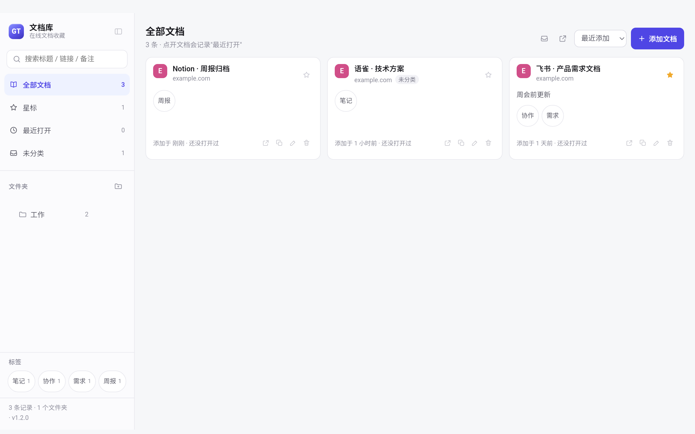

# 文档库 · Android 端（Tauri 2）

平板/手机上的「文档库」：同一套界面、同一套数据模型，数据存在本机（localStorage），
通过 JSON 与桌面版互相导入导出。

> 只做了 Android。选 Tauri 2 而不是 PWA，是为了拿到真正的系统 App 体验（图标、
> 返回键、文件选择器、剪贴板、分享），同时复用桌面端的 `library.js` / `shell.css`。



## 和桌面版的差别

| | 桌面版（Electron） | Android 端（Tauri） |
|---|---|---|
| 打开文档 | 应用内标签页 + webview | 交给系统浏览器（Chrome） |
| 数据存储 | `library.json`（0600） | 本机 localStorage |
| 导入导出 | 数据文件放在固定目录 | 界面右上角「导入 / 导出」按钮 |
| 下载管理 | 有 | 不需要（下载归浏览器管） |

为什么不能内嵌打开：第三方网页普遍禁止被 iframe 嵌入（`X-Frame-Options` / CSP），
WebView 里也拿不到稳定的多标签体验。交给 Chrome 的另一个好处是登录态留在浏览器里，
不会因为清了应用数据而掉登录。

## 目录结构

```
mobile/
├── prepare.js              # 把共享的 library.js/shell.css/store-core.js 和 web-src/* 拼成 web/
├── scripts/patch-gradle.js # 给生成的 Android 工程打补丁（Maven 镜像、应用名、node 转发脚本）
├── web-src/                # Android 端自己的页面
│   ├── index.html          # 布局（复用桌面端的类名，去掉标签栏）
│   ├── bridge.js           # window.api 的本地实现（localStorage + Rust 命令）
│   ├── shell-mobile.js     # 外壳：打开文档、折叠侧栏、导入导出弹窗
│   └── mobile.css          # 移动端适配（安全区、触控尺寸）
└── src-tauri/              # Rust 侧
    ├── src/lib.rs          # 只暴露两个命令：open_url / app_version
    ├── tauri.conf.json     # 标识 com.gt.docvault，frontendDist=../web
    └── .cargo/config.toml  # crates.io 走中科大镜像
```

`web/`、`src-tauri/gen/`、`src-tauri/target/` 都是生成的，不进仓库。

## 一次性准备

```bash
# 1. Rust 交叉编译目标
rustup target add aarch64-linux-android armv7-linux-androideabi x86_64-linux-android

# 2. Android NDK（没有 cmdline-tools 时直接下压缩包）
curl -L -o ndk.zip https://dl.google.com/android/repository/android-ndk-r27c-darwin.zip
unzip -q ndk.zip -d .cache-android/ndk

# 3. 前端依赖 + 图标 + 生成 Android 工程
cd mobile
npm install
npx tauri icon ../build/icon.png
export JAVA_HOME=$(/usr/libexec/java_home)
export ANDROID_HOME="$HOME/Library/Android/sdk"
export NDK_HOME="$PWD/../.cache-android/ndk/android-ndk-r27c"
export GRADLE_USER_HOME="$PWD/../.cache-android/gradle"   # 别写进 ~/.gradle
export ANDROID_SDK_HOME="$PWD/../.cache-android/android-home"
npx tauri android init --ci
node scripts/patch-gradle.js      # 打完补丁才能编译（见下）
```

### 为什么需要 patch-gradle.js

`src-tauri/gen/android` 是 `tauri android init` 生成的，里面有三处在这台机器/这个项目上必须改：

1. **Google Maven 连不上**（`Could not GET …aaptcompiler-9.3.1.pom > Remote host terminated the handshake`）
   → 在每个 `google()` 前插入阿里云镜像；
2. **Gradle 的 rust 任务用 `node tauri …` 调 CLI**，而 node 把 `tauri` 当成"当前目录下的文件"
   → 在 `src-tauri/tauri` 放一个转发脚本 `require('@tauri-apps/cli/tauri.js')`；
3. **桌面图标名**由 Gradle 工程决定，默认是 ASCII 的 `DocVault` → 改成 `文档库`。

脚本是幂等的，重新 `android init` 之后再跑一次即可。

## 构建

```bash
cd mobile
export JAVA_HOME=$(/usr/libexec/java_home)
export ANDROID_HOME="$HOME/Library/Android/sdk"
export NDK_HOME="$PWD/../.cache-android/ndk/android-ndk-r27c"
export GRADLE_USER_HOME="$PWD/../.cache-android/gradle"
export ANDROID_SDK_HOME="$PWD/../.cache-android/android-home"

npm run android:build          # 出未签名的 release APK
# 或只要调试包（自带 debug 签名，可直接装）：
npx tauri android build --apk --debug --target aarch64
```

未签名的 release 包要用自己的密钥签一次才能安装：

```bash
BT="$HOME/Library/Android/sdk/build-tools/36.0.0"
PASS=$(grep storePassword .android-keys/keystore.properties | cut -d= -f2)
"$BT/zipalign" -p -f 4 \
  src-tauri/gen/android/app/build/outputs/apk/universal/release/app-universal-release-unsigned.apk \
  /tmp/aligned.apk
"$BT/apksigner" sign --ks .android-keys/docvault-release.keystore \
  --ks-pass "pass:$PASS" --ks-key-alias docvault --key-pass "pass:$PASS" \
  --out ../dist/DocVault-Android-1.2.0-arm64.apk /tmp/aligned.apk
```

> **`.android-keys/` 千万别删**。Android 用签名判断"是不是同一个应用"，
> 换了密钥就只能先卸载再装，应用数据（localStorage 里的文档库）会一起丢掉。
> 这个目录已经写进 `.gitignore`，请自己另外备份一份。

生成的包约 5.6 MB（debug 包 118 MB，因为带全部 ABI 的调试符号）。

## 安装

```bash
adb install -r dist/DocVault-Android-1.2.0-arm64.apk
```

或者把 APK 拷到平板上，用文件管理器点开安装（需要允许"安装未知来源应用"）。

## 数据怎么在两端之间搬

**桌面 → Android**：桌面版把 `library.json` 复制出来（侧栏底部「打开数据文件位置」），
发到平板（云盘/邮件/微信都行），在 Android 端点右上角「导入」→「选择文件」。

**Android → 桌面**：Android 端点右上角「导出」→「复制全部」或「分享到…」，
把 JSON 贴到任意能同步的地方，在电脑上存成 `library.json` 覆盖过去（覆盖前先备份）。

导入支持两种模式：

- **合并**：只补库里没有的（按 id 或链接去重），不动现有数据；
- **覆盖**：用文件内容替换整个库（先导出备份再覆盖）。

校验规则和桌面版是同一份代码（`src/store-core.js`）：只接受 http/https、
标题/备注/标签都有长度上限、坏条目丢弃而不是整库失败。

## 已验证

在 Pixel_Tablet（Android 15，arm64）模拟器上跑过：

- 冷启动、空状态、列表渲染、搜索/文件夹/标签视图
- 添加文档、编辑、删除、星标
- 点文档 → 跳 Chrome，并记录"最近打开"
- 导入（粘贴 + 文件选择两条路径，合并/覆盖两种模式）、导出（复制）
- 侧栏折叠、安全区留白（状态栏不遮挡、底部栏不被手势条切掉）
- `open_url` 只放行 http/https（`file://` 会被拒绝）